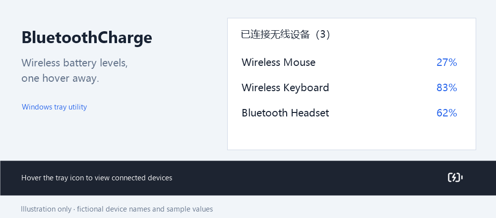

# BluetoothCharge · Windows 无线设备电量提醒

[English](README.en.md) · [下载最新版](https://github.com/jiangxin1245234785-stack/BluetoothCharge/releases/latest) · [设备兼容性](docs/COMPATIBILITY.md) · [更新记录](CHANGELOG.md)

一个常驻 Windows 托盘的小工具：查看已确认连接的无线设备电量，在电量低于设定阈值时提醒充电。支持 Windows 能报告电量的蓝牙设备、标准 BLE Battery Service，以及范围有限的罗技 USB 无线鼠标适配。

当前程序界面为简体中文，附英文使用说明。

**能连接或正常使用，不代表设备一定公开电量。** 没有有效数据时显示“未知”，不猜测百分比，也不把未知当成 0%。



*图片是匿名合成示例，设备名称及数值仅用于演示。*

## 可以做什么

- 悬停托盘查看已确认连接的无线设备，包括蓝牙和受支持的 USB 无线鼠标。电量未知的设备仍显示；较长清单自动展开可滚动卡片。
- 为每个设备设置低电量阈值、提醒冷却时间和忽略规则，也可继承全局设置。忽略提醒不会把已连接设备从悬停清单中隐藏。
- 后台定时扫描，并监听蓝牙设备新增、移除和连接状态变化。可随时手动刷新。
- 使用 Windows 通知提醒，冷却记录跨重启保存；可选择登录 Windows 后自启。
- 在本机保存配置和诊断。程序不上传数据，不依赖云端服务。

默认每 **5 分钟**扫描一次，低于 **20%** 提醒，同一设备两次提醒至少间隔 **4 小时**。阈值采用严格“小于”：20% 阈值下，19% 提醒，20% 不提醒。

## 安装和运行

目标平台为 **Windows 10 2004 / build 19041 及以上、Windows 11**。发布包面向 **Windows x64**；日常运行不需要管理员权限、Python 或 .NET SDK。

1. 在仓库右侧 **Releases** 或[下载页面](https://github.com/jiangxin1245234785-stack/BluetoothCharge/releases/latest)选择 `win-x64` 的 **self-contained（自包含）ZIP**，推荐普通用户使用。
2. 完整解压到固定目录，双击 `BluetoothCharge.exe`。请保留随包的 DLL 和子目录；不要只复制 EXE。
3. 首次打开设备与设置窗口。关闭窗口后程序仍在托盘运行；双击托盘图标重新打开设置，右键可扫描、测试通知或退出。
4. 选择设备，调整阈值、冷却时间或忽略规则，点击“保存此设备”。需要自启时勾选“登录 Windows 后启动”，再点击“应用自启”。

体积较小的 **light / framework-dependent** 包需要另装 [.NET 10 Windows Desktop Runtime x64](https://dotnet.microsoft.com/en-us/download/dotnet/10.0)。仅有普通 .NET Runtime 或 .NET 8 不足；自包含包无需另装运行时。

自启在当前用户登录后生效。启用后请保持程序目录不变；移动目录时，在新位置重新应用自启。更新前先从托盘退出，再替换完整发布目录。配置位于独立的数据目录。

便携版删除前，先退出程序，再在其目录执行 `.\BluetoothCharge.exe --unregister`，清理本程序的自启与通知注册，然后删除程序目录。配置和日志可自行保留或删除。

## 哪些设备能读到电量

| 路径 | 支持范围与限制 |
| --- | --- |
| Windows 设备属性 | 优先读取 Windows / 驱动已提供的电量。适用于部分键盘、鼠标、耳机等；属性可能缺失或是缓存值。 |
| 标准 BLE | 系统没有有效电量时，对当前已连接的 BLE 设备尝试 Battery Service `180F` / Battery Level `2A19`。需设备提供服务并允许访问。此后备路径仍需要更多真实设备验证。 |
| 罗技 USB HID++ | 专用适配仅覆盖 **`046D:C54D` 接收器的无线槽位 1**，已在该组合上验证百分比读取。不能推导为其他罗技型号、接收器、槽位或所有 G HUB 版本都支持。 |
| 其他 USB 接收器 | 可能显示设备或接收器，但电量未知；需要逐型号的厂商协议适配。USB 接收器接入不等于鼠标无线在线。 |
| 手机、多电池耳机等 | 蓝牙配对本身不足以保证电量可见。手机可能需要伴随应用，耳机左右单元和充电盒可能使用私有协议。 |

已识别的有线 G502 HERO 标为“无需充电”，不属于无线充电提醒清单。此判断不适用于名称相似的无线型号。

只有**连接已确认且本轮取得有效电量**时才判断是否提醒。离线缓存、电量未知、连接状态未知和仅接收器接入均不会触发低电量提醒。Windows 属性没有设备实际采样时间，界面的读取时间只是本工具的查询时间；即使设备已连接，也不能保证系统属性实时更新。多个组件或属性返回不同百分比时取最低值，详情保留冲突和来源。

程序使用 C# / .NET 10、WinForms、WinRT 与 SetupAPI；后台扫描不启动 PowerShell。HID++ 路径只发送读取查询，不修改配对、按键、DPI 或固件。标准 BLE 读取前检查连接，但连接检查后的断线竞态仍可能让 Windows 自行重连。

完整接口调查、公开属性与经验性属性的区别、协议来源和型号限制见 [COMPATIBILITY.md](docs/COMPATIBILITY.md)。有限的实测范围与未验证项见 [VALIDATION.md](docs/VALIDATION.md)，不以自动测试代替设备兼容性证明。

## 设备缺失、电量未知或没有提醒

1. 先在 Windows“蓝牙和设备”中检查名称、配对及连接状态，并确认设备的连接通道对应这台电脑。本工具不会自动配对附近设备。
2. 点击“重新扫描设备”。“没有设备行”和“已有设备但电量未知”是不同问题；系统枚举晚到时会继续加入清单。
3. 查看设备详情中的传输方式、来源及错误。USB 接收器应按 USB / 厂商协议排查，而不是视为电脑蓝牙连接。
4. 使用“测试通知”检查实际呈现，并核对 Windows 通知开关和勿扰设置。通知提交成功不代表横幅一定显示。
5. 仍有问题时，使用[设备兼容性模板](https://github.com/jiangxin1245234785-stack/BluetoothCharge/issues/new?template=device-compatibility.yml)或[错误报告模板](https://github.com/jiangxin1245234785-stack/BluetoothCharge/issues/new?template=bug-report.yml)，提供版本、型号、连接方式和复现步骤。

## 配置、诊断与隐私

配置保存在 `%LOCALAPPDATA%\BluetoothCharge`：`config.json` 保存规则，`state.json` 保存提醒冷却记录，`app.log` 保存滚动日志。设置窗口可打开数据目录或导出诊断 JSON。

**诊断可能包含个人设备名称、蓝牙 / MAC 地址、ContainerId、USB / HID 实例路径及序列号。** 公开提交前请检查分享副本，删除或一致替换这些标识以及 Windows 用户名和本机路径；只保留排查必需的信息。不要直接上传整个数据目录，也不要为了脱敏修改正在使用的配置文件。

需要单次查询时，可在程序目录执行：

```powershell
.\BluetoothCharge.exe --probe
# 关闭 BLE 后备读取；仍会查询受支持的罗技 HID++ 设备：
.\BluetoothCharge.exe --probe --no-ble
```

查询后退出，并在数据目录生成 `diagnostics.json`。这些命令会访问真实设备，不属于无需硬件的自动测试。

## 从源码构建

需要 Windows 和符合 [global.json](global.json) 的稳定 **.NET 10 SDK**，当前基线为 `10.0.401`。首次构建需要联网恢复依赖。

在仓库根目录的 PowerShell 中执行：

```powershell
.\build.ps1 -Dotnet dotnet
```

脚本先运行自动检查，再将自包含版本发布到 `dist\win-x64`。较小的依赖运行时版本可使用 `.\build.ps1 -Dotnet dotnet -FrameworkDependent`；`-Runtime win-arm64` 是可构建目标，尚未实机验证。

仅运行无需蓝牙 / HID 硬件的测试：

```powershell
dotnet run --project .\tests\BluetoothCharge.Tests\BluetoothCharge.Tests.csproj -c Release
```

测试使用自定义控制台检查程序，因此使用 `dotnet run`。Windows CI 检查构建和这些测试，不代表已验证真实蓝牙通信、通知横幅、所有系统版本或所有厂商设备。

生成可分发的两个 ZIP（包含说明、许可与 SHA-256 校验文件）：

```powershell
.\scripts\package-release.ps1 -Dotnet dotnet
```

输出位于 `artifacts`。发布给他人时请使用这个打包入口，保留第三方许可文件。

## 参与贡献与许可

欢迎提交中文或英文的问题报告、兼容性记录和改进。请先阅读 [CONTRIBUTING.md](CONTRIBUTING.md)；新增厂商支持需要明确型号 / VID:PID、协议依据、失败处理及无需真实设备的回归检查。

项目代码采用 [MIT 许可证](LICENSE)。随附运行时、通知库和图标保留各自许可，见 [THIRD-PARTY-NOTICES.md](THIRD-PARTY-NOTICES.md)。
